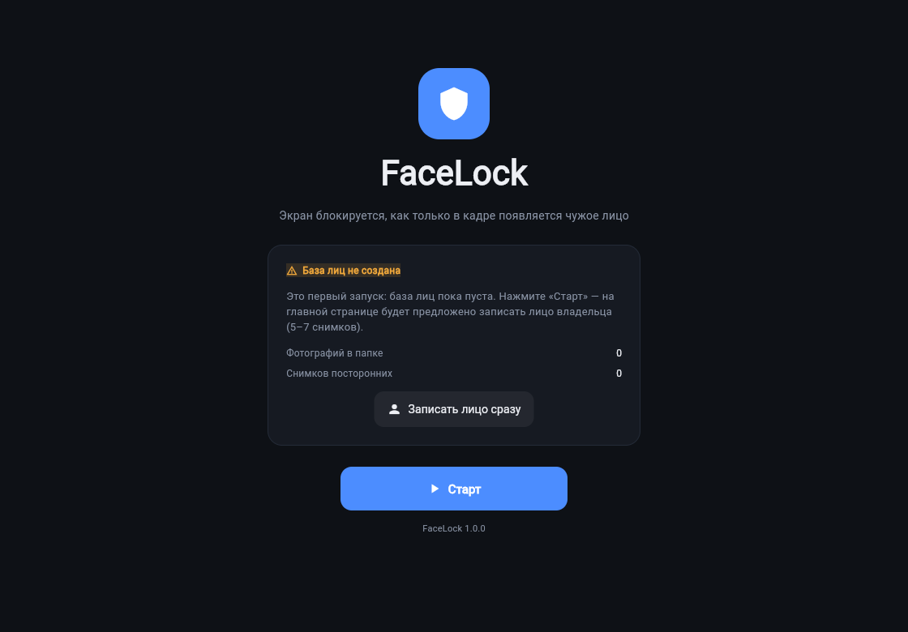
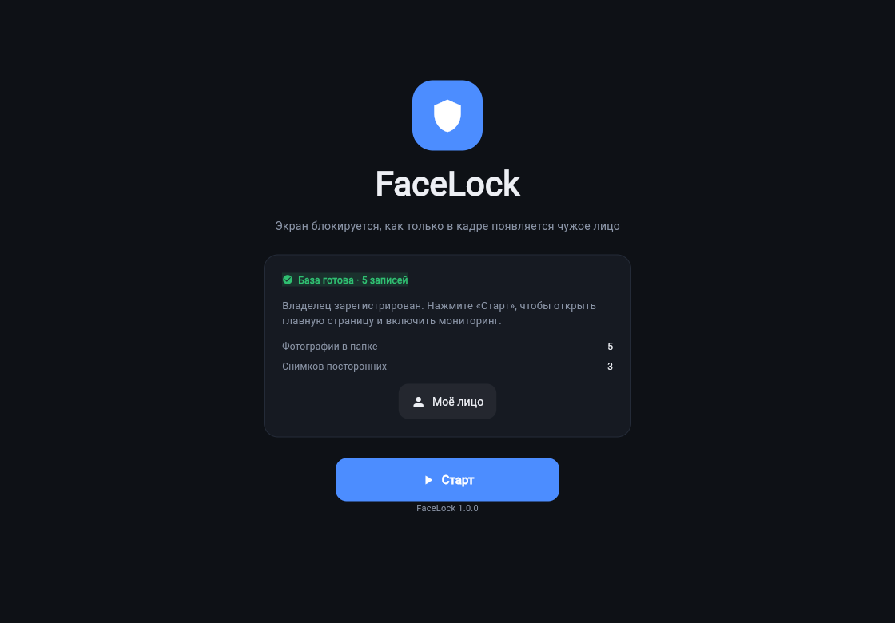
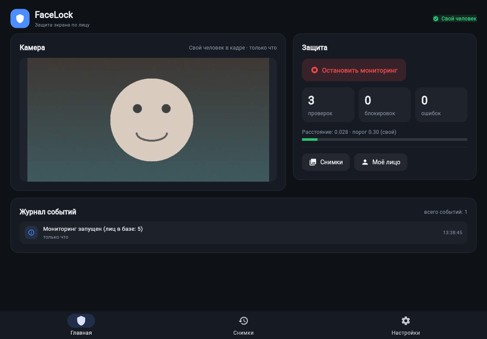
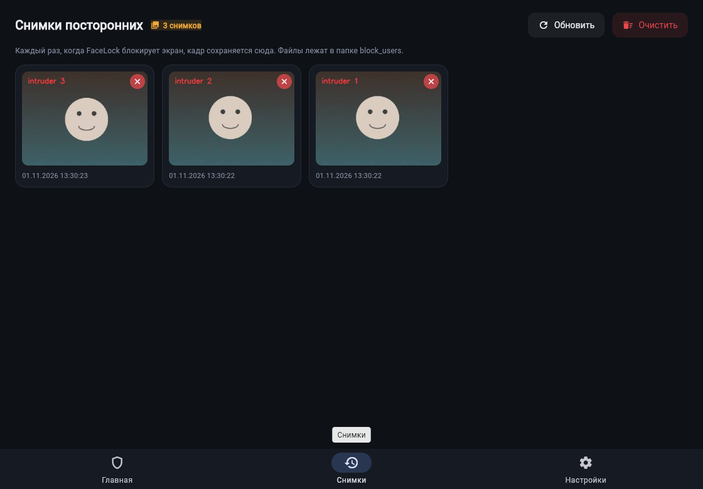
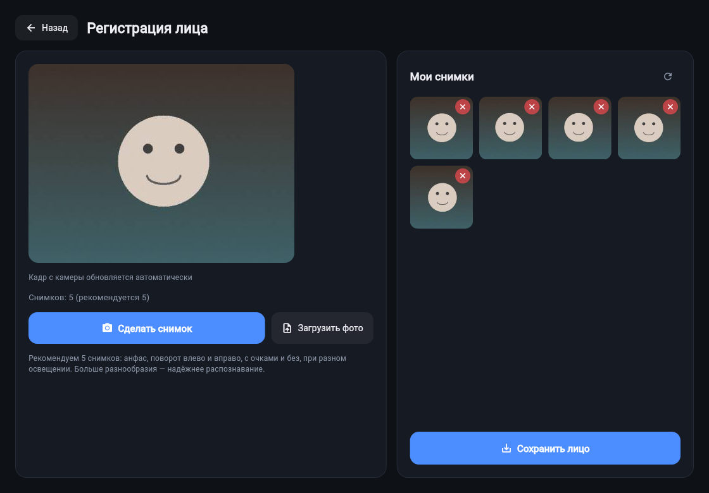
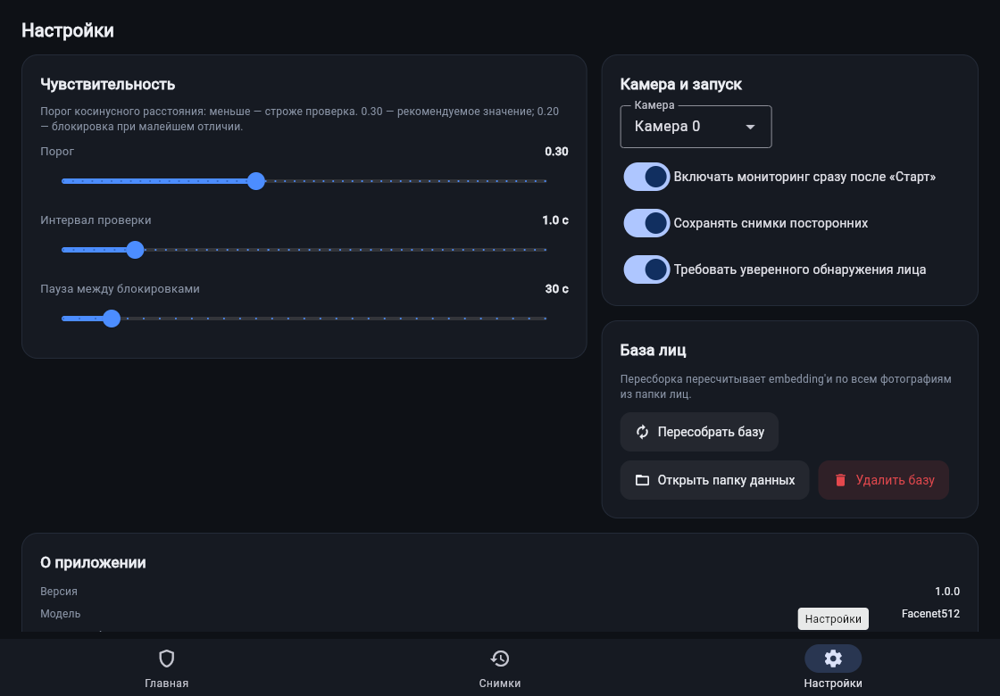

# FaceLock

Приложение для автоматической блокировки экрана компьютера: как только перед
камерой появляется человек, чьё лицо не совпадает с зарегистрированным,
экран блокируется, а снимок нарушителя сохраняется в журнал.

Версия 1.0 — с полноценным интерфейсом на **Flet 1.0**: регистрация лица прямо
с камеры, запуск и остановка мониторинга, журнал снимков и настройки. Вся
логика распознавания вынесена в `backend/` и используется и графическим
интерфейсом, и консольным режимом.

| Первый запуск (базы ещё нет) | Стартовое окно, база готова |
|---|---|
|  |  |

| Главная страница | Журнал событий и снимки |
|---|---|
|  |  |

| Регистрация лица | Настройки |
|---|---|
|  |  |

---

## Как это работает

1. Программа раз в секунду (интервал настраивается) берёт кадр с веб-камеры.
2. [DeepFace](https://github.com/serengil/deepface) (модель **Facenet512**,
   детектор `opencv`) строит embedding — числовой вектор лица.
3. Вектор сравнивается с базой из `embeddings.pkl` по косинусному расстоянию.
4. Если минимальное расстояние больше порога (`0.30` по умолчанию) — лицо
   считается чужим: экран блокируется, кадр сохраняется в `block_users/`,
   в журнал добавляется событие.

Приложение рассчитано на одного пользователя компьютера: база хранит
embedding'и владельца, любое другое лицо — посторонний.

## Что умеет интерфейс

- **Стартовое окно.** При запуске проверяется база лиц. Если её нет — окно об
  этом сообщает, и после кнопки «Старт» на главной странице появляется баннер с
  предложением записать лицо. Если база есть — сразу видно число записей.
- **Регистрация лица.** Живой предпросмотр с камеры, кнопка «Сделать снимок»,
  загрузка готовых фотографий, удаление неудачных снимков. Кнопка «Сохранить
  лицо» строит базу embedding'ов в фоновом потоке и показывает прогресс; первый
  запуск дольше — загружается модель Facenet512.
- **Главная страница.** Статус проверки (свой / посторонний / нет лица / экран
  заблокирован), живой кадр, кнопка пуска и остановки мониторинга, счётчики
  проверок, блокировок и ошибок, текущее расстояние до владельца и порог,
  журнал последних событий.
- **Снимки посторонних.** Галерея кадров из `block_users/` с датой, удаление по
  одному и полная очистка с подтверждением.
- **Настройки.** Порог чувствительности, интервал проверки, пауза между
  блокировками, выбор камеры, автостарт мониторинга, сохранение снимков,
  пересборка и удаление базы, показ путей к данным. Настройки сразу сохраняются
  в `data/settings.json` и применяются на лету.

## Структура проекта

```
FACELOCK/
├── main.py                 # точка входа Flet-приложения (и сборки)
├── config.py               # общие настройки, пути, settings.json
├── pyproject.toml          # зависимости и параметры flet build
├── requirements.txt
├── requirements-ai.txt     # DeepFace + werkzeug (TensorFlow не нужен)
├── install_ai.py           # установка и диагностика ИИ-части
├── check_env.py            # проверка всего окружения
├── backend/
│   ├── camera.py           # CameraManager: потокобезопасный захват кадров
│   ├── database.py         # база лиц: построение, сравнение, снимки
│   ├── monitor.py          # FaceMonitor: цикл проверки и блокировка
│   ├── funct.py            # блокировка экрана (Windows / macOS / Linux)
│   └── FaceLock.py         # консольная версия без интерфейса
├── UI/
│   ├── app.py              # ft.run(main), тема, реестр экранов
│   ├── state.py            # AppContext: камера, монитор, фоновые задачи
│   ├── theme.py            # цвета и переиспользуемые элементы
│   └── screens/            # start, dashboard, register, history, settings
├── tests/                  # быстрые проверки без камеры и без ИИ
├── data/                   # создаётся автоматически
│   ├── known_face/         # фотографии владельца
│   ├── embeddings.pkl      # база embedding'ов
│   └── settings.json       # настройки
└── block_users/            # снимки посторонних
```

## Установка

Нужен Python 3.8+ (проверено на 3.11–3.13). TensorFlow **не требуется**:
DeepFace 0.0.103 считает Facenet512 в формате ONNX через onnxruntime, поэтому
установка занимает ~200 МБ вместо ~800 МБ.

```bash
git clone https://github.com/vnigas/FACELOCK.git
cd FACELOCK

python -m venv venv
source venv/bin/activate        # macOS / Linux
venv\Scripts\activate           # Windows

python -m pip install -r requirements.txt   # интерфейс и камера
python install_ai.py                        # распознавание лиц
```

Две установки — не прихоть: базовые зависимости ставятся быстро и всегда, а
ИИ-часть можно доставлять отдельно. Приложение запускается и без неё: интерфейс,
камера, история и настройки работают, недоступно только распознавание.

Что за `requirements.txt`:

* `flet[all]` — важно: одного ядра `flet` мало, для окна нужен `flet-desktop`,
  для браузера — `flet-web`, для сборки — `flet-cli`. Если поставить просто
  `pip install flet`, запуск упадёт с
  `ModuleNotFoundError: No module named 'flet_desktop'`.
* `opencv-python`, `numpy`, `scipy`, `Pillow` — камера, картинки, расстояния.

Что делает `install_ai.py`: проверяет Python и платформу, ставит `deepface` и
`werkzeug` (DeepFace импортирует его, но не указывает в зависимостях — без него
падает `ModuleNotFoundError: No module named 'werkzeug'`), затем загружает модель
и, если всплыл ещё какой-то недокументированный модуль, доставляет его сам.

```bash
python install_ai.py --check     # только диагностика, ничего не ставит
python install_ai.py --with-tf   # дополнительно TensorFlow (не обязательно)
```

Проверить всё окружение целиком:

```bash
python check_env.py     # пакеты, файлы проекта, импорты, модель, камера
```

## Запуск

```bash
python main.py            # настольное окно
python main.py --web      # в браузере, если окно недоступно
flet run main.py          # режим отладки Flet (горячая перезагрузка с -d)
```

Первый запуск «Сохранить лицо» занимает до минуты: подгружаются веса DeepFace
(около 90 МБ, нужен интернет). Дальше модель берётся из локального кеша.

Консольный режим без интерфейса:

```bash
python backend/FaceLock.py
```

## Регистрация лица

1. На стартовом окне нажать **Старт**, затем в баннере — **Записать лицо**
   (или кнопку «Моё лицо»).
2. Сделать 5–7 снимков: анфас, повороты влево и вправо, в очках и без, при
   разном освещении. Можно добавить готовые фотографии кнопкой «Загрузить фото»
   (JPG или PNG; HEIC с iPhone нужно предварительно конвертировать).
3. Нажать **Сохранить лицо** — база построится автоматически.

Чем разнообразнее снимки, тем надёжнее распознавание. Если приложение часто
принимает вас за постороннего — добавьте снимков или поднимите порог в
настройках; если наоборот, пускает чужих — понизьте порог.

## Настройки

`data/settings.json` (меняются из интерфейса, применяются сразу):

| Параметр | Что означает | По умолчанию |
|---|---|---|
| `threshold` | порог косинусного расстояния (меньше — строже) | `0.30` |
| `check_interval` | пауза между проверками, сек | `1.0` |
| `lock_cooldown` | не блокировать чаще, чем раз в N сек | `30` |
| `camera_index` | индекс камеры для `cv2.VideoCapture` | `0` |
| `model_name` | модель DeepFace | `Facenet512` |
| `detector_backend` | детектор лиц | `opencv` |
| `required_photos` | рекомендация по числу снимков | `5` |
| `auto_start` | включать мониторинг сразу после «Старт» | `false` |
| `save_snapshots` | сохранять снимки посторонних | `true` |
| `enforce_detection` | требовать уверенного обнаружения лица | `true` |

### Камера и её индикатор

Камера в системе одна, и открывать её нужно аккуратно, иначе индикатор
начинает мигать.

- Захват идёт в одном фоновом потоке; интерфейс и монитор читают последний
  кадр из одного и того же `CameraManager`, поэтому устройство не открывается
  дважды.
- Открытие и закрытие сериализованы мьютексом: параллельные `open()` не
  приводят к повторному захвату устройства.
- Камера остаётся открытой, пока идёт мониторинг или на экране есть превью, и
  отпускается только через **45 секунд** без надобности (`AppContext.CAMERA_GRACE`).
  Без этой задержки переходы по меню закрывали и снова открывали камеру —
  индикатор мигал.
- Кадр в превью обновляется с `gapless_playback`, поэтому картинка не
  «пропадает» между кадрами.

Если нужно, чтобы камера отпускалась сразу — уменьшите `CAMERA_GRACE` в
`UI/state.py`.

### Где лежат данные

- при запуске из репозитория — в каталоге проекта (`data/`, `block_users/`);
- в собранном приложении каталог проекта только для чтения, поэтому данные
  переезжают в системный каталог:
  Windows `%APPDATA%\FaceLock`, macOS `~/Library/Application Support/FaceLock`,
  Linux `~/.local/share/FaceLock`;
- путь можно задать вручную переменной `FACELOCK_DATA_DIR`.

Старая база `backend/embeddings.pkl` и фотографии из `data/known_face`
переносятся автоматически при первом запуске из нового места.

## Сборка приложения

Flet сам скачивает нужный Flutter SDK при первой сборке (нужен интернет и
~2 ГБ на диске). Собирать нужно **на целевой ОС**.

```bash
flet build windows        # .exe/каталог приложения → build/windows
flet build macos          # .app → build/macos
flet build linux          # .AppImage/каталог → build/linux
flet build web            # статический сайт → build/web
```

Параметры берутся из `pyproject.toml` (`[tool.flet]`): название, организация,
bundle id, а также `permissions = ["camera"]` — это добавляет
`NSCameraUsageDescription` и entitlements, без которых macOS не даст доступ к
камере.

Особенности по платформам:

- **macOS.** При первом запуске разрешить доступ к камере. Блокировка —
  `pmset displaysleepnow`.
- **Windows.** Блокировка — `LockWorkStation()`. Для сборки нужен Visual Studio
  Build Tools (Flet/Flutter предупредит).
- **Linux.** Блокировка — первая сработавшая команда из `loginctl lock-session`,
  `gnome-screensaver-command --lock`, `xdg-screensaver lock`, `dm-tool lock`,
  `swaylock`. Проверка «экран уже заблокирован» — через `loginctl` /
  `gnome-screensaver`.

Сборка тянет вместе с приложением DeepFace и его зависимости (~200 МБ; ONNX-веса
Facenet512 скачиваются уже на первом запуске приложения, а не на этапе сборки).
Если ставить TensorFlow (`--with-tf`), итоговый размер вырастает ещё на несколько
сотен мегабайт — для Facenet512 он не нужен.

Внутри собранного приложения нет интернета по умолчанию: первый запуск на
компьютере пользователя скачает веса модели в `~/.deepface/weights`, если сети
нет — распознавание сообщит об ошибке, интерфейс продолжит работать.

## Тесты (без камеры и без ИИ)

```bash
python tests/smoke_backend.py   # база, монитор, блокировка, cooldown, снимки
python tests/smoke_ui.py        # сборка всех экранов, навигация, настройки
```

Оба скрипта работают на заглушках: `FACELOCK_FAKE_AI=1` (embedding'и из
пикселей) и `FACELOCK_FAKE_CAMERA=1` (синтетические кадры), данные пишутся во
временный каталог.

## Переменные окружения для разработки

| Переменная | Назначение |
|---|---|
| `FACELOCK_DATA_DIR` | каталог данных (фото, база, настройки, снимки) |
| `FACELOCK_FAKE_CAMERA=1` | синтетические кадры вместо веб-камеры |
| `FACELOCK_FAKE_AI=1` | псевдо-embedding'и вместо DeepFace (быстро, без весов модели) |
| `FACELOCK_START_SCREEN` | стартовый экран: `start`, `dashboard`, `register`, `history`, `settings` |

Демонстрация интерфейса без камеры и модели:

```bash
FACELOCK_FAKE_CAMERA=1 FACELOCK_FAKE_AI=1 flet run --web main.py
```

## Частые проблемы

| Симптом | Причина и решение |
|---|---|
| «Камера не найдена или занята» | камеру держит другое приложение (Zoom, OBS); закройте его или смените индекс камеры в настройках |
| Первый запуск очень долгий | один раз загружается модель Facenet512, прогресс виден на экране регистрации |
| Блокирует владельца | добавьте снимков в других условиях или поднимите порог до 0.35–0.40 |
| Не блокирует посторонних | понизьте порог до 0.20–0.25, увеличьте частоту проверок |
| Экран не блокируется на Linux | не установлена ни одна из поддерживаемых утилит блокировки |
| `ModuleNotFoundError: No module named 'werkzeug'` | DeepFace импортирует werkzeug, но не указывает его в зависимостях. Лечение: `python -m pip install werkzeug` (или `python install_ai.py`) |
| `ImportError: DeepFace` / «DeepFace/TensorFlow не удалось загрузить» | `python install_ai.py` в активированном venv |
| `pip install deepface` падает | не ставьте руками: `python install_ai.py` сам проверит Python, сеть и место на диске и объяснит причину |
| `No module named 'tensorflow'` | он и не нужен: модель считается через onnxruntime. Если DeepFace старой версии — `python -m pip install -U deepface` |
| Первый запуск распознавания долгий | один раз скачиваются веса Facenet512 (94 МБ, ONNX), дальше они берутся из локального кеша |
| `ModuleNotFoundError: No module named 'flet_desktop'` (или `'flet_web'`) | установлено только ядро Flet: `python -m pip install "flet[all]==1.0.5"` |
| `python main.py` висит без вывода | та же причина (Flet пытается дотянуть недостающий компонент); запустите `python check_env.py` или `python main.py --web` |
| «Загрузить фото» ничего не делает | обновитесь до версии из этой ветки: в веб- и мобильной версии Flet не отдаёт путь к файлу, теперь содержимое запрашивается через `with_data=True` и импортируется из байтов |
| Мигает индикатор камеры, превью дёргается | обновитесь до версии из этой ветки: открытие камеры сериализовано, устройство больше не переоткрывается при переходах по меню, у превью включён `gapless_playback` |

## Лицензия

MIT
